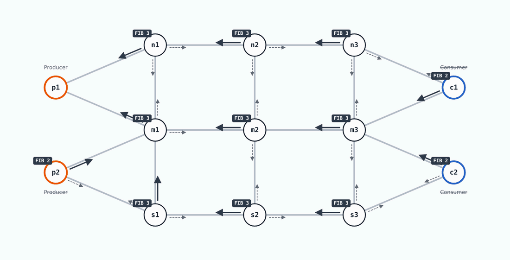

# NDN Web Animation

**[Open the animation in your browser](https://brunosfer.github.io/ndn-web-animation/web/)**

A conceptual study of how Named Data Networking (NDN) forwarding strategies behave in a wireless multi-hop network, built to show their problems clearly as groundwork for a new forwarding strategy.

The study is a single web page with no backend, the NDN Strategy Lab. It animates a small topology with redundant paths, two producers on the left and two consumers on the right that mirror each other:

<picture>
  <source media="(prefers-color-scheme: dark)" srcset="docs/topology-dark.gif">
  
</picture>

Each producer and consumer reaches a hub (m1 or m3) and an outer row. The outer links cost 12 and the diagonals to the hubs 10, so the middle row is the main path and the north and south rows are detours, with no equal-cost ties. p2 is off by default. A seeded discrete-event simulator mirrors the forwarding rules of NFD 24.07 (PIT, Content Store, Dead Nonce List, Best Route, ASF, Multicast and Self-Learning), the hello, sync and LSA traffic of NLSR, the ndnping and ndnget consumers of ndn-tools and the frame timing and shared medium of wmediumd. Every property and its source is listed in the page's "Model and sources" section, together with the result of checking it in Mini-NDN-WiFi. The checks were made with version 1.1 of the model; later versions add features and give the same results in every profile.

## How faithful it is

Why the Lab was built, how it was checked against Mini-NDN on Mininet-WiFi (setup, number of runs and seeds, criteria) and how closely each metric agrees are summarised in [`docs/validation.md`](docs/validation.md).

## Run it

Use the link at the top, or clone the repository and open [`web/index.html`](web/index.html) in a browser. It works offline and loads nothing from the network.

* **Profiles** load a scenario with timed events that shows where one strategy fails, for example a broken link, a lossy link, a dead neighbour, a producer that leaves, two producers of the same data, a file and a stream sharing the radio and the caches, or a live stream with no time for a retransmission. You can switch strategy, faces (unicast, multicast or both) and routing (static, NLSR or none) on any profile to compare.
* **Manual mode** lets you change the network while the animation runs. A table lists every node with its radio switch, its caching switch, buttons that clear its Content Store, FIB or PIT, and a checkbox per link. Clicking a node or a link on the map opens its tables (faces, FIB, PIT, Content Store, ASF, NLSR, counters) and its loss, cost and flapping settings.
* **Applications:** a table lists p1 and p2 (producers), c1 and c2 (consumers) and m2, which can be a relay, a producer or a consumer. Each one is switched on or off, starts at its own time and chooses its kind of data: Sensor (small readings at a fixed frequency), File (ndnget), Stream (a live camera stream with a playout buffer, in the style of NDN-RTC) or Ping (ndnping). Every kind of data in use has its own name, its own strategy and sliders for its data size (a file from 10 KB to 100 MB; a stream frame from 1 to 64 KB, by default 2 KB at 30 frames per second, like a low-resolution camera), frequency and, for the stream, the buffer, the frames asked for ahead, the Interest lifetime and the retransmission timer. Two producers of the same kind serve the same data. The Content Store capacity and a radio queue limit can be set for all nodes.
* **The Network card** shows how busy the shared medium is: the air time used by NDN and NLSR frames, the idle time and how much is still queued for the medium, beside the frame counters, the losses and the waste. Next to it, the producer and consumer cards count what each application sent and received.
* **Transmission efficiency** shows what every frame on the medium was (Interests and Data needed or extra, Nacks, NLSR) and, per node, the Interests and Data sent and received, duplicates, suppressed retransmissions and losses. The map shows each link's cost and what each node's strategy ranks its faces by, for all links or only the path in use. After every disruption (a link out of range or lossy, a radio or a cache off, a producer leaving) the efficiency panel shows for each consumer the recovery time, until its share of satisfied requests is back within 10% of its level before, and the recovery effort, the extra frames and air time the network spent meanwhile, with the data gap and the strategy's reaction time. A Key indicators card above the Network card sums up delivery, timeliness, cost, resilience and reaction. Every metric is defined in [`docs/metrics.md`](docs/metrics.md).
* **Transport:** play, pause, step, restart and fast-forward, with speeds from ½× to 8×; while paused the speed buttons set how many events one step runs. The page follows the system's light or dark theme until you choose one with the toggle in the header.
* **Measure all profiles** runs every profile with and without NLSR, without animation, and fills the profile table.

## Self-test

`tests/selftest.sh [output.json]` opens the page headless in Chrome or Chromium with `#selftest`, which runs every profile with and without NLSR, and prints one line per run.

## How to cite

If you use NDN Web Animation in academic work, please cite it as described in [`CITATION.cff`](CITATION.cff).

## License

NDN Web Animation is free and open source software licensed under the
[Apache License, Version 2.0](https://www.apache.org/licenses/LICENSE-2.0). See [`LICENSE`](LICENSE)
and [`NOTICE`](NOTICE) for details. It reimplements the behaviour of NFD, NLSR, PSync, ndn-tools and wmediumd from their source code without including their code; they are separate projects under their own licenses (GPL-3.0, LGPL-3.0 and GPL-2.0-or-later).

Questions and bug reports are welcome as [GitHub issues](https://github.com/brunosfer/ndn-web-animation/issues).
